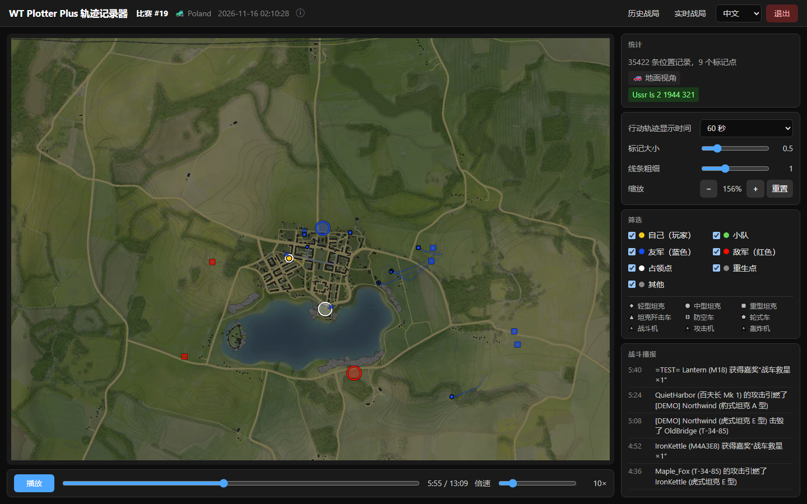
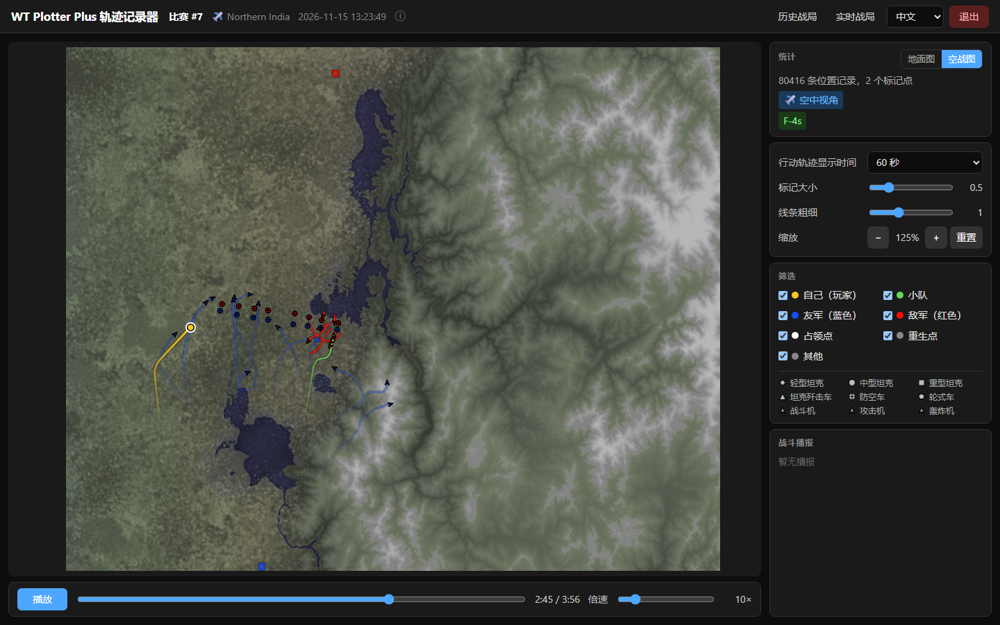
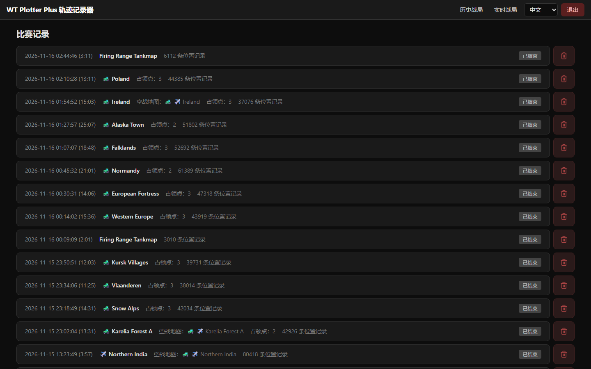
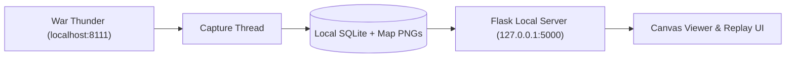

<div align="center">

# WT Plotter Plus

**Real-time tactical minimap & match replay plotter for War Thunder on Windows.**

*(rebuilt from [ElBartt/WarThunder-Plotter](https://github.com/ElBartt/WarThunder-Plotter), MIT)*

Local-first battlefield telemetry recorder and browser replay viewer. Reads only the game's built-in `localhost:8111` web map—never touches game memory or files, and keeps every recording on your machine.

[](https://github.com/EvergardenRoxy/WarThunder-Plotter-Plus/releases)
[](LICENSE)
[](#quick-start)
[](#install-from-source)
[](README.zh-CN.md)

[Quick start](#quick-start) · [Features](#features) · [Screenshots](#screenshots) · [Shortcuts](#keyboard-shortcuts) · [How it works](#how-it-works) · [Documentation](#documentation) · [AI statement](#ai-statement)

</div>

---

## Quick start

### Portable EXE (recommended)

1. Download `WarThunderPlotterPlus-portable.exe` from [GitHub Releases](https://github.com/EvergardenRoxy/WarThunder-Plotter-Plus/releases).
2. Place it in any writable folder and double-click to launch.
3. Start a War Thunder match—your browser opens on the **Live** view and begins plotting automatically.

### Install from source

Requires **Python 3.11+** with the Windows Python Launcher (`py`):

```powershell
scripts\setup.bat
.\.venv\Scripts\python -m wt_plotter
```

### CLI modes

```text
WarThunderPlotterPlus-portable.exe            capture and open the live page (default, same as watch)
WarThunderPlotterPlus-portable.exe serve      browse recorded matches without capturing
WarThunderPlotterPlus-portable.exe capture    capture only, no web UI
```

The web UI listens on `http://127.0.0.1:5000` by default (configurable via `--host` and `--port`). Click **Quit** in the top-right bar or the Windows system tray icon to stop cleanly.

---

## Features

- **[Automatic capture & map recognition](docs/en/capture.md)** — Starts when you enter a battle and stops when you leave. Recognizes maps via minimap dHash, distinguishes ground, air, and naval battles, and detects nuke matches from both map transitions and HUD events.
- **[Tactical HUD replay viewer](docs/en/viewer.md)** — Continuous age-faded trails per team, unit-class shapes (light/medium/heavy tanks, tank destroyers, SPAA, IFVs, fighters/attackers/bombers), crew-knockout `×` marks with knockout timestamps, and capture-zone tooltips.
- **[Live tracking & instant rewind](docs/en/viewer.md#live-match)** — Designed for a second monitor: watch the live battlefield, drag back at any time to inspect an earlier play, and click **Back to live** (`L`) when done.
- **[Focus mode & camera controls](docs/en/viewer.md#sidebar-settings)** — Collapsible sidebar (`B`), **Follow me** camera lock (`F`, auto-releases on manual drag), smooth zoom/pan (50%–500%), adjustable map darkening (0%–60%), and compact 11-step playback speed (`0.5×`–`50×`).
- **[Sortie timeline & air map switch](docs/en/viewer.md#ground-map-and-air-map)** — Clickable sortie pills below the playbar jump straight to each actual vehicle spawn (ignoring spawn-screen clicks). Combined-arms matches support toggling between **Ground** and **Air** maps.
- **[Filterable battle feed](docs/en/viewer.md#battle-feed)** — Records `/hudmsg` combat, award, nuke, and departure messages with `All / Combat / Awards / Hide leaves` filters, color-coded timeline ticks, and click-to-seek synchronization.
- **[Rich match history](docs/en/viewer.md#match-history)** — Grouped by local start date with map thumbnails, spawned sortie vehicle chips, nuke badges, aligned Start/Duration columns, and combined map/date/mode filtering.
- **[Game replay import](docs/en/replay.md)** — Imports local `.wrpl` replays and downloads server replays by session id, adding a per-match report with every player's team, score, kills and vehicles, the player kill log, and chat. Replays also rebuild aircraft tracks (air battles) or ground unit and aircraft tracks (ground battles), so matches without an 8111 recording can be played back, with player names and vehicles on hover.
- **Bilingual UI** — Switch between English and Simplified Chinese in the top bar (defaults to your Windows display language on first launch).

---

## Screenshots

| Ground battle replay | Air battle replay |
| :---: | :---: |
|  |  |

<details>
<summary>Match history screenshot</summary>



</details>

> Screenshots show the Chinese interface with fictional player names in the battle feed.

---

## Keyboard shortcuts

| Key | Action |
| :--- | :--- |
| `Space` | Play / Pause |
| `←` / `→` | Step backward / forward 5s (`Shift` for 15s) |
| `[` / `]` | Decrease / increase playback speed |
| `F` | Toggle **Follow me** camera lock |
| `B` | Collapse / expand sidebar (focus mode) |
| `R` or `0` | Reset map zoom and position |
| `L` | Return to live edge (Live view) |

---

## How it works



- **Read-only local telemetry**: polls `map_info.json`, `map_obj.json`, `map.img`, `indicators`, and `hudmsg` from War Thunder's official local web-map port.
- **No memory reading, no game file changes**: completely passive and local-only; all recordings are stored in `data/matches.db` and `data/maps/`.

---

## Documentation

| Guide | Topic |
| :--- | :--- |
| [Capture & map recognition](docs/en/capture.md) | Telemetry polling, map dHash lookup, air-to-ground transform |
| [Match viewer](docs/en/viewer.md) | Map legend, replay controls, live rewind, battle feed |
| [Game replays](docs/en/replay.md) | Import local and server replays, replay report, file format |
| [Data, settings & updates](docs/en/data.md) | Storage layout, browser settings, portable auto-updater |
| [Architecture](docs/en/architecture.md) | Module design and source file index |
| [Database](docs/en/database.md) | SQLite schema and enum tables |
| [Development guide](docs/en/development.md) | Running tests and building Windows executables |
| [Translation](docs/en/translation.md) | Adding or updating UI locales |
| [Changelog](CHANGELOG.md) | Full release history |

---

<a id="ai-statement"></a>

## AI statement

[](#ai-statement)
[-4285F4?style=flat-square&logo=google&logoColor=white)](#ai-statement)

This project is developed with AI coding assistants under human direction, testing, and review:

- **Core rebuild (`v0.1`–`v0.4.6`)**: Rebuilt from scratch on top of `ElBartt/WarThunder-Plotter`—**Claude Fable 5.2** handled architecture design, data verification, and review, while **Claude Opus 5.5** wrote most of the core implementation.
- **UI polish, viewer enhancements & bug fixes (`v0.4.7+`)**: **Google Antigravity (Gemini)** contributed the tactical HUD visual redesign, match history thumbnails/vehicle chips/column headers, focus mode, follow-me camera, adjustable map darkening, compact speed stepper, keyboard shortcuts, sortie timeline, battle feed semantic filtering (including War Thunder Chinese zero-width-space handling), nuke & air-view fixes, player color-flash fix, tests, and documentation updates.

---

## Origins and credits

Rebuilt from [ElBartt/WarThunder-Plotter](https://github.com/ElBartt/WarThunder-Plotter), keeping its database schema and map hash table foundation. Thanks also to **Sgambe33** for [WT-Plotter](https://github.com/Sgambe33/WT-Plotter) (trail plotting and map hashes) and **ValerieOSD** for [WarThunderRPC](https://github.com/ValerieOSD/WarThunderRPC).

This project is not affiliated with Gaijin Entertainment.

## License

Distributed under the [MIT License](LICENSE).
