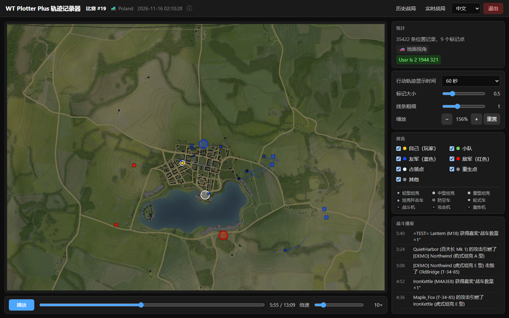
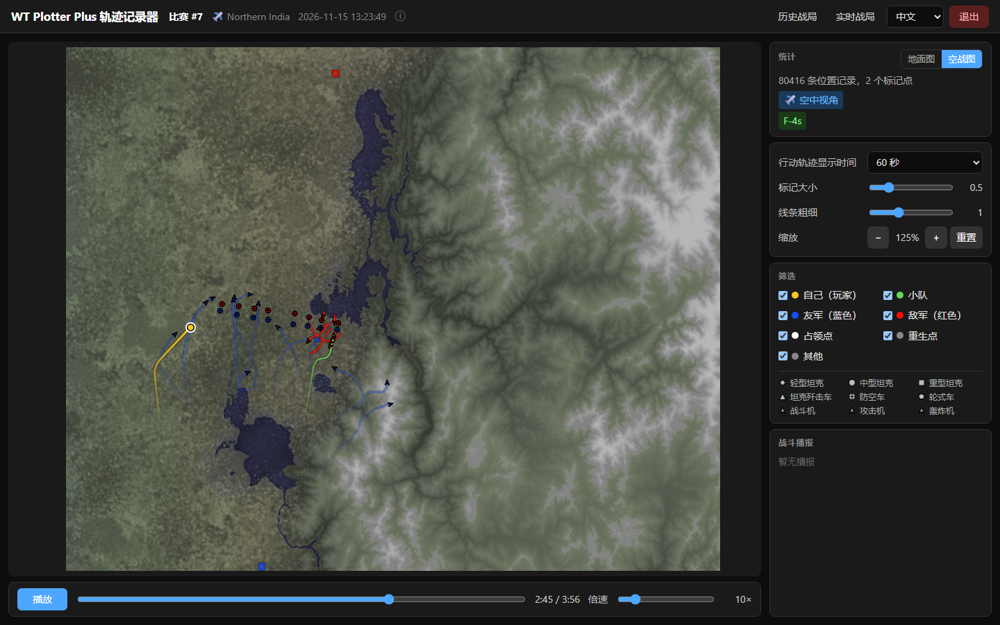
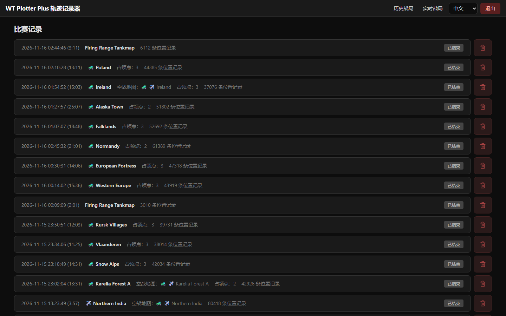
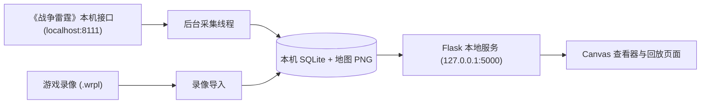

<div align="center">

# WT Plotter Plus

**适用于 Windows 的《战争雷霆》实时战术小地图与战局轨迹回放器**

*（重建自 [ElBartt/WarThunder-Plotter](https://github.com/ElBartt/WarThunder-Plotter)，MIT 协议）*

本地优先的战场遥测记录与浏览器回放工具。只读取游戏客户端自带的 `localhost:8111` 网页小地图接口和游戏自己的 `.wrpl` 录像，不读内存、不改游戏文件，所有记录均保存在本机。

[](https://github.com/EvergardenRoxy/WarThunder-Plotter-Plus/releases)
[](LICENSE)
[](#快速开始)
[](#源码运行)
[](README.md)

[快速开始](#快速开始) · [核心功能](#核心功能) · [界面预览](#界面预览) · [快捷键](#快捷键) · [工作原理](#工作原理) · [文档导航](#文档导航) · [AI 参与声明](#ai-制作声明)

</div>

---

## 快速开始

### 便携版 EXE（推荐）

1. 前往 [GitHub Releases](https://github.com/EvergardenRoxy/WarThunder-Plotter-Plus/releases) 下载 `WarThunderPlotterPlus-portable.exe`。
2. 放进任意可写文件夹，双击运行。
3. 启动《战争雷霆》进入对局，浏览器会自动打开「实时战局」并开始绘制轨迹。

### 源码运行

需要安装 **Python 3.11+** 及 Windows Python Launcher（`py`）：

```powershell
scripts\setup.bat
.\.venv\Scripts\python -m wt_plotter
```

### 命令行模式

```text
WarThunderPlotterPlus-portable.exe            采集并打开实时页面（默认，等同 watch）
WarThunderPlotterPlus-portable.exe serve      只看历史战局，不采集
WarThunderPlotterPlus-portable.exe capture    只采集，不开网页
```

网页默认监听 `http://127.0.0.1:5000`（可用 `--host` 和 `--port` 修改）。点击页面右上角或 Windows 系统托盘中的「退出」即可安全关闭。

---

## 核心功能

- **[自动采集与地图识别](docs/zh/capture.md)** — 进入战局自动开始录制、离场自动结束。通过小地图 dHash 自动识别地图名，区分陆战、空战与海战，并结合切图与播报识别核弹局。
- **[战术 HUD 战局查看器](docs/zh/viewer.md)** — 各阵营轨迹按时间连续渐隐；轻/中/重坦、坦歼、防空车、步战车与各型飞机拥有独立形状；悬停阵亡 `×` 可查看兵种与阵亡时刻，悬停占领点可查看归属与时间。
- **[实时战局与即时倒带](docs/zh/viewer.md#实时战局)** — 非常适合副屏常驻：对局中同步刷新态势，随时拖动时间轴回看刚才的走位与交火，按「回到实时」（`L`）即可无缝追回最新进度。
- **[专注模式与视角控制](docs/zh/viewer.md#侧栏设置)** — 支持一键折叠侧栏（`B`）、视角「跟随自己」（`F`，手动拖拽自动解除）、滚轮缩放与平移（50%～500%）、底图压暗强度调节（0%～60%）以及 11 档紧凑倍速器（`0.5×`～`50×`）。
- **[出击时间线与空地底图切换](docs/zh/viewer.md#地面图与空战图)** — 播放条下方展示我方实际出击载具胶囊（自动跳过选车界面误点），点击可直达换车时刻；包含空中视角的陆战对局可在「地面图 / 空战图」间随时切换。
- **[战斗播报筛选与联动](docs/zh/viewer.md#战斗播报)** — 完整记录 `/hudmsg` 击毁、击落、起火、嘉奖、核弹与离场消息，支持「全部 / 战果 / 嘉奖 / 隐藏离开」筛选，时间轴按事件类型着不同色标，点击播报直达对应时刻。
- **[历史战局一览](docs/zh/viewer.md#历史战局)** — 按本地开局日期分组，展示地图缩略图、本局实际出击载具与 `☢ 核弹` 徽章，支持地图名、日期和战局类型组合筛选；有录像的比赛可展开「战绩」查看两队成绩。
- **[游戏录像导入](docs/zh/replay.md)** — 导入游戏录像文件夹、任意 `.wrpl` 文件，或按场次号下载服务器录像，自动关联同一场的 8111 记录，为比赛补上战报：全体玩家的队伍、得分、击杀与载具，玩家击杀记录和聊天。录像还能还原陆、空、海三种战斗的轨迹（含 8111 看不到的敌方单位），没有 8111 记录的比赛也能回放，悬停单位可看玩家名与载具。
- **中英文双语界面** — 顶栏随时切换中英文，首次启动自动跟随 Windows 系统显示语言。

---

## 界面预览

| 陆战回放 | 空战回放 |
| :---: | :---: |
|  |  |

<details>
<summary>历史战局列表预览</summary>



</details>

> 截图中的战斗播报使用虚构玩家昵称。

---

## 快捷键

| 按键 | 功能 |
| :--- | :--- |
| `Space` | 播放 / 暂停 |
| `←` / `→` | 后退 / 前进 5 秒（按住 `Shift` 为 15 秒） |
| `[` / `]` | 降低 / 提高回放倍速 |
| `F` | 开关「跟随自己」视角锁定 |
| `B` | 收起 / 展开侧栏（专注模式） |
| `R` 或 `0` | 复位地图缩放与位置 |
| `L` | 回到实时最新时刻（实时战局） |

---

## 工作原理



- **纯只读本机遥测**：仅轮询游戏内置网页地图的 `map_info.json`、`map_obj.json`、`map.img`、`indicators` 与 `hudmsg`。
- **录像只读解析**：读取游戏录像目录里的 `.wrpl`；只有按场次号下载服务器录像时才联网。
- **零侵入、纯本地**：不读取进程内存、不修改任何游戏文件，所有记录均保存在本地 `data/matches.db` 与 `data/maps/` 中。

---

## 文档导航

| 文档 | 内容 |
| :--- | :--- |
| [采集与地图识别](docs/zh/capture.md) | 遥测轮询机制、dHash 地图识别、空地坐标换算 |
| [战局查看器](docs/zh/viewer.md) | 读图图例、回放控制、实时倒带、战斗播报 |
| [游戏录像](docs/zh/replay.md) | 导入本地与服务器录像、录像战报、文件格式 |
| [数据、设置与更新](docs/zh/data.md) | 存储目录、浏览器设置、便携版自动更新 |
| [架构与文件索引](docs/zh/architecture.md) | 系统模块划分与源码文件速查表 |
| [数据库](docs/zh/database.md) | SQLite 表结构与枚举设计 |
| [开发指南](docs/zh/development.md) | 运行测试与打包 Windows 可执行文件 |
| [翻译指南](docs/zh/translation.md) | 维护与扩展多语言词条 |
| [变更日志](CHANGELOG.zh-CN.md) | 完整版本更新记录 |

---

<a id="ai-制作声明"></a>

## AI 参与声明

[](#ai-制作声明)
[-4285F4?style=flat-square&logo=google&logoColor=white)](#ai-制作声明)

本项目在人工主导、实测验收与审查下，结合多款 AI 编程助手协作完成：

- **整体重建阶段（`v0.1`～`v0.4.6`）**：在 `ElBartt/WarThunder-Plotter` 基础上从零重建——**Claude Fable 5.2** 负责架构设计、数据核对与代码复核，**Claude Opus 5.5** 完成了核心功能实现。
- **界面升级、交互增强与缺陷修复（`v0.4.7+`）**：**Google Antigravity (Gemini)** 参与完成了战术 HUD 深色视觉升级、历史战局缩略图/载具标签/列头注释、专注模式侧栏折叠、视角跟随、底图压暗调节、紧凑倍速器与复盘快捷键、出击时间线、战报语义筛选（含中文零宽空格兼容）、核弹与空战视角识别修复、本人图标变蓝/双标修复，以及配套测试与文档更新。
- **游戏录像支持（`v0.5+`）**：**Claude Opus 5.5** 完成了 `.wrpl` 录像格式分析、轨迹还原与战报，并用实战的 8111 记录逐场核对。

---

## 来源与致谢

本项目重建自 [ElBartt/WarThunder-Plotter](https://github.com/ElBartt/WarThunder-Plotter)，沿用了它的数据库结构和地图哈希表基础，在此特别感谢。同时感谢 **Sgambe33** 的 [WT-Plotter](https://github.com/Sgambe33/WT-Plotter)（轨迹绘制与地图哈希）以及 **ValerieOSD** 的 [WarThunderRPC](https://github.com/ValerieOSD/WarThunderRPC)。

本项目与 Gaijin Entertainment 没有关联。

## 开源许可

本项目采用 [MIT 许可证](LICENSE)。
