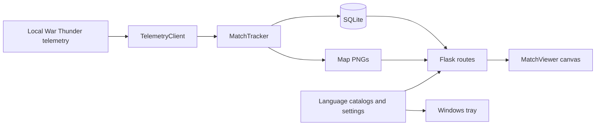

[← Back to README](../../README.md) · [简体中文](../zh/architecture.md)

# Architecture

`wt_plotter.cli` starts the selected mode. In `watch` mode, the CLI starts a capture thread and a threaded Werkzeug server. The web and tray quit actions call the same HTTP shutdown route. When the server returns, the CLI waits for capture to finish, closes the match, and stops the tray.

- `capture/client.py` requests map validity first. The capture thread reads indicators and objects on valid ticks, and the tracker requests map images for starts, air views, and map changes.
- `capture/tracker.py` receives time, telemetry, a database connection, and an image callback. It can record synthetic ticks without the game. `air_transform.py` fits the air-to-ground mapping from paired map objects.
- `maps/lookup.py` resolves map IDs and battle types by exact or fuzzy dHash. Display names are resolved from the current catalog when the web response is built.
- `storage/db.py` owns the database schema and query shapes. The capture thread and each HTTP request open their own connections.
- `web/` renders pages through Jinja. The browser combines tick metadata with positions by `tick_id` for real-time display and replay.
- While the map is valid, the capture thread also polls `/hudmsg`. The first batch of each match only advances the cursor; later messages go into the `events` table. If the endpoint is unavailable the feed is skipped and tracking continues.
- Shared front-end modules: `settings.js` keeps viewer settings in localStorage, `shapes.js` draws unit class shapes, and `tracks.js` links tracks. `viewer.js` handles drawing, the air map switch and the feed list. Trails are split by age into 40 opacity levels and drawn on a separate layer that is then composited onto the map; each level first erases the area it will cover, so semi-transparent lines do not darken where they join or cross.

## File Index

> Look up application code under `wt_plotter/` and matching `tests/`; `reference/` is kept only for upstream historical comparison.

| Path | Responsibility |
| :--- | :--- |
| `wt_plotter/cli.py` | CLI entry point (mode dispatch such as `watch` / `web` and shutdown cleanup) |
| `wt_plotter/config.py` | Data paths, web server defaults, local 8111 telemetry endpoints, and settings |
| `wt_plotter/process_lock.py` | Windows file lock preventing duplicate capture instances |
| `wt_plotter/capture/client.py` | Local War Thunder 8111 HTTP client (map, objects, indicators, `/hudmsg`) |
| `wt_plotter/capture/capturer.py` | Background capture loop and runtime status reporting |
| `wt_plotter/capture/tracker.py` | Match state machine recording matches, ticks, positions, events, and map images |
| `wt_plotter/capture/air_transform.py` | Air-to-ground coordinate transform fitting from paired map objects |
| `wt_plotter/maps/dhash.py` | Map image dHash computation and Hamming distance |
| `wt_plotter/maps/lookup.py` | Exact/fuzzy dHash lookup for map ID and battle mode |
| `wt_plotter/maps/table.py` | Built-in map hash and metadata lookup table |
| `wt_plotter/storage/db.py` | SQLite schema (`matches` / `ticks` / `positions` / `events` + enum tables) and queries |
| `wt_plotter/web/app.py` | Flask page routes and JSON APIs (matches, positions, events, status, language, shutdown) |
| `wt_plotter/web/templates/` | Jinja HTML templates (`base` / `index` / `match` / `waiting`) |
| `wt_plotter/web/static/viewer.js` | Main canvas viewer (live/replay, trail fade, air map switch, death markers) |
| `wt_plotter/web/static/app.js` | Page UI bindings (language, match deletion, status polling, playback & filter controls) |
| `wt_plotter/web/static/{settings,shapes,tracks,i18n,match_utils}.js` | Shared frontend utilities: localStorage settings, unit shapes, track linking, i18n, feed & sortie helpers |
| `wt_plotter/web/static/styles.css` | Application and viewer stylesheet |
| `wt_plotter/desktop/tray.py` | Windows system tray icon and menu |
| `wt_plotter/desktop/updater.py` | GitHub Release update checker |
| `wt_plotter/i18n/` | Locale loader and translation catalogs (`locales/en.json`, `locales/zh.json`) |
