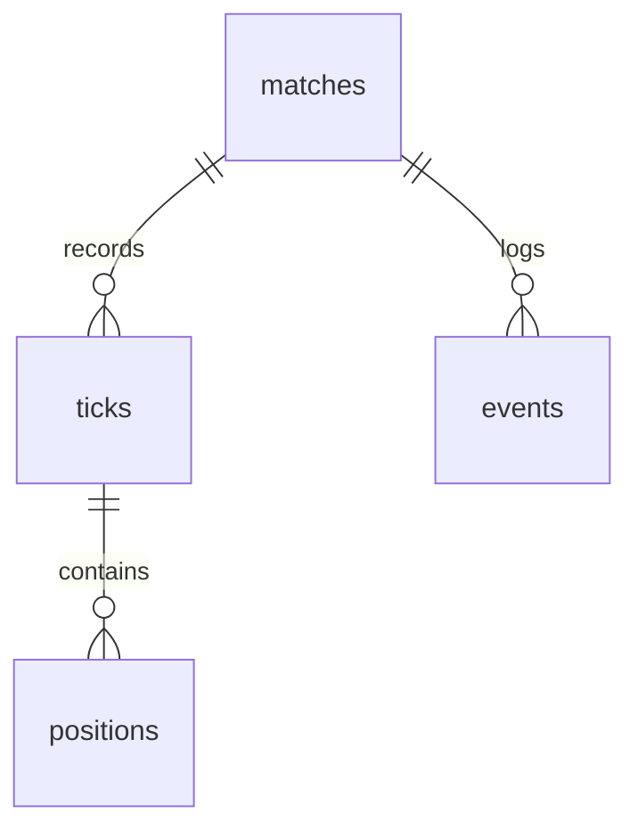

[← Back to README](../../README.md) · [简体中文](../zh/database.md)

# Database

This project keeps the SQLite schema from the upstream v0.2.0 release. `storage/db.py` holds the schema in `_create_tables`. Match rows store the base and air map hashes, capture-zone summary, nuke flag, and air-view transform. The web layer derives map IDs, names, and battle types from the hashes.

## Normalized rows

A tick holds the match ID, timestamp in integer milliseconds, vehicle and army IDs, and the air-view flags. Position rows reference the tick and store object coordinates, color, type, icon, and POI flag. Coordinates use five decimal places, and transformed ground coordinates may be null.

The enum tables hold distinct strings shared by positions and ticks. Each connection caches enum IDs, and only committed IDs enter that cache. This saves repeated text and allows the API to send each tick once with positions referring to it by `tick_id`.

The `events` table stores the battle feed: match ID, receive time in milliseconds from match start (the same base as ticks), the game's message ID, the message text, and the raw JSON entry.

## Replay tables

`replays` holds one row per imported replay, unique by session id and server flag, and references its match. `replay_players`, `replay_kills` and `replay_chat` store player results, the player kill log and chat; times are milliseconds from the replay start. Re-importing a replay replaces its rows, and deleting a match removes them. `replays.wrote_tracks` marks whether that replay wrote the match's tracks; `replays.parser_version` records the full-parse version: folder imports read only the summary and store 0, and opening a match fully parses replays below the current version. A failed full parse stores the current version and the reason in `replays.parse_error`. `map_bounds` stores each minimap's world bounds under the same key as the map image. See [Game replays](replay.md).

## Reads and cleanup

`GET /api/match/<id>/positions` returns `ticks` and `positions`. Integer `since` values are milliseconds and decimal values are seconds. The filter includes the given timestamp. The viewer joins the returned arrays and uses mapped ground coordinates when available. Positions written from replays also carry `unit_name` and `unit_vehicle` (player name and vehicle, stored as `positions.unit_name_id` → `enum_unit_names` and `positions.unit_vehicle_id` → `enum_vehicle_types`); they are null for 8111 recordings. `GET /api/match/<id>/events?since=<ms>` returns feed messages in time order. It localizes departure messages and returns one departure per player at each timestamp.

The app uses WAL and a database connection per capture thread or web request. Deleting a finished match removes its feed messages, positions, ticks, and match row in one transaction, then requests incremental vacuum. Existing databases retain their SQLite auto-vacuum mode. At capture startup, matches left active by an interrupted run are marked ended.
