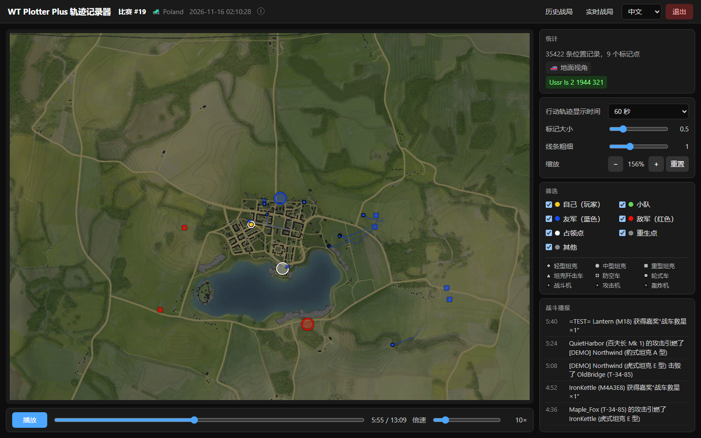
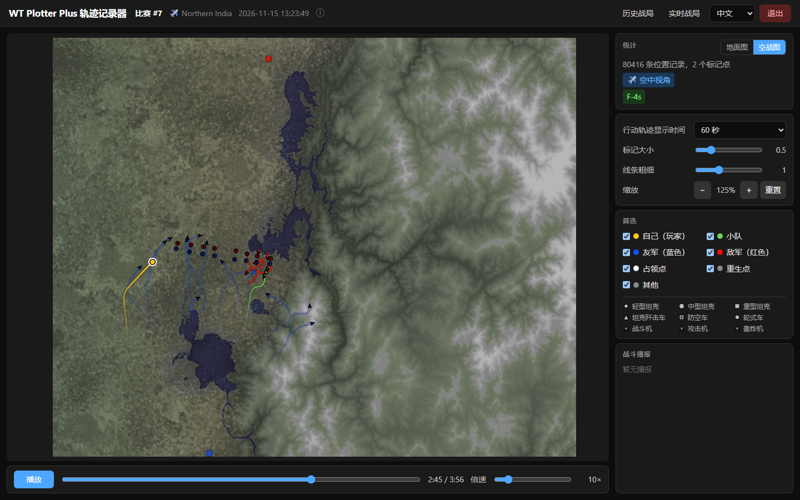

[← Back to README](../../README.md) · [简体中文](../zh/viewer.md)

# Match viewer

Matches in the navigation bar lists every recorded match; click one to open its replay. Live shows the match in progress. Both pages share the same map and sidebar.

## Reading the map

- **Color is the team**: yellow is you, green is your squad, blue is allies, red is enemies, gray is everything else.
- **Shape is the unit class**: diamond for light tanks, circle for medium tanks, square for heavy tanks, triangle for tank destroyers, crossed circle for SPAA, pentagon for wheeled vehicles and IFVs, arrow for aircraft (fighters, attackers and bombers in growing size). You are a dot with a white ring. The sidebar has a legend.
- **Lines are trails**: drawn back from the current position and fading with age. Arrows point along the last piece of the trail.
- **× marks a death**: only for you, your squad and allies. A trail must have stopped for more than 6 seconds to count.
- **Large circles are capture zones**, colored by current owner (blue, red, or white for neutral). **Small squares are respawns.**
- Hover over a unit to see its class. Hovering over yourself also shows your vehicle model.

Artillery, pillboxes, ships and fixed air defence are not shown yet.

Enemy units are on the minimap only while spotted. One that reappears within 6 seconds rejoins its old trail, with no line drawn across the gap. An enemy that disappears is not necessarily dead, so enemies get no ×.

## Replay

The playback bar is under the map:

- **Play / Pause**: playback stops at the end. Pressing Play at the end restarts from the beginning.
- **Timeline**: drag to any moment.
- **Speed**: 5×–40×, 10× by default.

On the map, scroll to zoom (50%–500%), drag to pan, double-click to reset. The sidebar has zoom buttons too.

## Sidebar settings

| Setting | Notes |
| --- | --- |
| Trail duration | 10, 30, 60 or 120 seconds, or all. Default 30 seconds. "All" does not fade. |
| Blip size | 0.25–1.5, default 0.5 |
| Line width | 0.5×–2×, default 1 |
| Filters | Show or hide each team, capture zones and respawns |

These settings and the playback speed are saved in the browser and are still there next time. A different browser, or clearing site data, brings back the defaults.

## Ground map and air map

A ground battle in which you flew has two maps. Switch between them next to "Statistics" in the sidebar:

- **Ground map**: ground units. Units seen from the air are drawn here with converted coordinates.
- **Air map**: a larger area, showing only data from the time you spent in the air, aircraft included.

A match whose first sortie was an aircraft (an air battle) opens on the air map.

## Battle feed

The battle feed is at the bottom of the sidebar, newest first, and follows the timeline: it shows the messages up to the moment you are looking at. The text is in whatever language the game client was using and does not change with the interface language.

Matches recorded before 0.4.0 have no feed.

## Live match

If no match is in progress, the Live page waits and refreshes when one starts. During a battle it updates every 0.5 seconds. There is no playback bar and the newest moment is always shown; trail duration, filters and the other settings work the same way.

Turn on **Show all teammate death locations** to keep detected squad and allied death markers on the selected map after their trails fade. The viewer infers these markers from ended tracks. The squad and ally filters still apply.

When the match ends the page stays on it and the "Live" badge in the header changes to "Ended". When the next match starts the page moves to it. If the capture program has stopped, "Capture stopped" appears above the map.

## Match list

Matches are grouped by their local start date, newest first. Use the date field to show one day, or **All dates** to clear the filter. Each row shows a stable match number, start time, duration, map, initial capture zone count and position count. Use the bin button to delete a finished match and its positions and feed.
