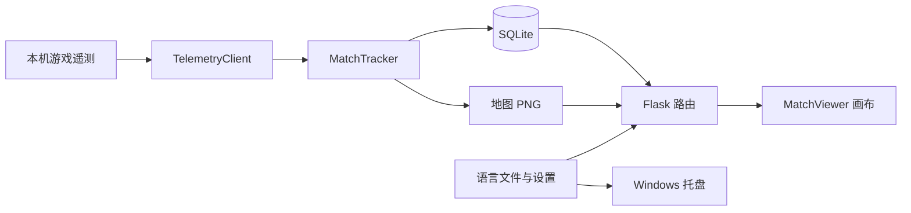

# 架构

[English](../en/architecture.md)

`wt_plotter.cli` 根据子命令启动程序。`watch` 启动采集线程和多线程 Werkzeug 服务。网页和托盘通过同一个 HTTP 路由关停服务。服务返回后，命令行等待采集线程退出、结束当前比赛并关闭托盘。

- `capture/client.py` 先请求地图有效性，采集线程在有效 tick 读取载具信息与地图对象，状态机按开局、空中视角与切图的需要取地图图片。
- `capture/tracker.py` 接收时间、遥测数据、数据库连接和取图函数，可脱离游戏重放合成数据。`air_transform.py` 从配对的地图对象拟合空中坐标到地面坐标的换算。
- `maps/lookup.py` 通过 dHash 精确或模糊查找地图 ID 和战斗类型。网页生成响应时用当前语言文件取得显示名。
- `storage/db.py` 定义数据库表结构和查询结果。采集线程与每个 HTTP 请求各用独立连接。
- `web/` 用 Jinja 渲染页面。浏览器按 `tick_id` 合并 tick 元数据与位置，供实时显示和回放使用。
