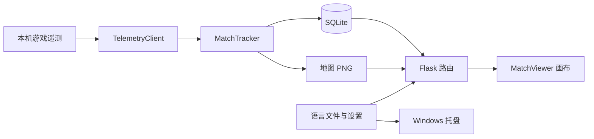

[← 返回 README](../../README.zh-CN.md) · [English](../en/architecture.md)

# 架构

`wt_plotter.cli` 根据子命令启动程序。`watch` 启动采集线程和多线程 Werkzeug 服务。网页和托盘通过同一个 HTTP 路由关停服务。服务返回后，命令行等待采集线程退出、结束当前比赛并关闭托盘。

- `capture/client.py` 先请求地图有效性，采集线程在有效 tick 读取载具信息与地图对象，状态机按开局、空中视角与切图的需要取地图图片。
- `capture/tracker.py` 接收时间、遥测数据、数据库连接和取图函数，可脱离游戏重放合成数据。`air_transform.py` 从配对的地图对象拟合空中坐标到地面坐标的换算。
- `maps/lookup.py` 通过 dHash 精确或模糊查找地图 ID 和战斗类型。网页生成响应时用当前语言文件取得显示名。
- `storage/db.py` 定义数据库表结构和查询结果。采集线程与每个 HTTP 请求各用独立连接。
- `web/` 用 Jinja 渲染页面。浏览器按 `tick_id` 合并 tick 元数据与位置，供实时显示和回放使用。
- 采集线程在地图有效时请求 `/hudmsg`。每场第一批消息只用来推进游标，之后的消息写入 `events` 表；接口不可用时跳过，不影响轨迹采集。
- 前端通用模块：`settings.js` 用 localStorage 读写查看器设置，`shapes.js` 绘制兵种形状，`tracks.js` 串联轨迹。`viewer.js` 负责业务绘制、空战图切换和播报列表。轨迹按时间分成 40 档不透明度，画在单独的图层上再叠到地图上；每档先擦掉自己要盖住的区域再描边，半透明线条的接头和交叉处不会叠深。

## 文件索引

> 排查业务代码以 `wt_plotter/` 与对应 `tests/` 为准；`reference/` 仅作上游历史参考。

| 路径 | 职责 |
| :--- | :--- |
| `wt_plotter/cli.py` | 命令行入口（`watch` / `web` 等模式调度与退出清理） |
| `wt_plotter/config.py` | 数据路径、服务端口、8111 遥测端点与默认参数 |
| `wt_plotter/process_lock.py` | Windows 进程互斥锁，防止采集多开 |
| `wt_plotter/capture/client.py` | 访问本机游戏 8111 接口（地图、对象、载具、`/hudmsg`） |
| `wt_plotter/capture/capturer.py` | 后台采集线程循环与状态暴露 |
| `wt_plotter/capture/tracker.py` | 对局状态机，写入对局、tick、位置、事件与地图图档 |
| `wt_plotter/capture/air_transform.py` | 空战图到地面图的仿射/缩放坐标换算 |
| `wt_plotter/maps/dhash.py` | 地图图片 dHash 计算与汉明距离 |
| `wt_plotter/maps/lookup.py` | 按 dHash 精确/模糊反查地图 ID 与战斗类型 |
| `wt_plotter/maps/table.py` | 内置地图哈希与元数据对照表 |
| `wt_plotter/storage/db.py` | SQLite 表结构（`matches` / `ticks` / `positions` / `events`、录像表及枚举表）与查询 |
| `wt_plotter/replay/` | 游戏录像：`wrpl.py` 文件与包流、`blk.py` 二进制 BLK、`messages.py` 击杀与玩家槽位、`tracks.py` 轨迹公共部分、`aircraft.py` 飞机轨迹、`ground.py` 地面单位轨迹、`positions.py` 轨迹转 tick 与位置、`importer.py` 入库、`download.py` 服务器录像下载 |
| `wt_plotter/web/app.py` | Flask 页面路由、JSON API（对局/位置/事件/状态/语言/关停） |
| `wt_plotter/web/templates/` | Jinja 页面模板（`base` / `index` / `match` / `waiting`） |
| `wt_plotter/web/static/viewer.js` | 画布主查看器（实时/回放、轨迹淡出、空战切换、死亡标记） |
| `wt_plotter/web/static/app.js` | 页面交互绑定（语言、删对局、状态轮询、播放与筛选控件） |
| `wt_plotter/web/static/{settings,shapes,tracks,i18n,match_utils}.js` | 前端通用模块：本地设置、兵种图形、轨迹拼接、前端翻译、战报与出击工具 |
| `wt_plotter/web/static/styles.css` | 全部页面与查看器样式 |
| `wt_plotter/desktop/tray.py` | Windows 系统托盘图标与菜单 |
| `wt_plotter/desktop/updater.py` | GitHub Release 更新检查 |
| `wt_plotter/i18n/` | 多语言加载器与词条文件（`locales/en.json`、`locales/zh.json`） |
