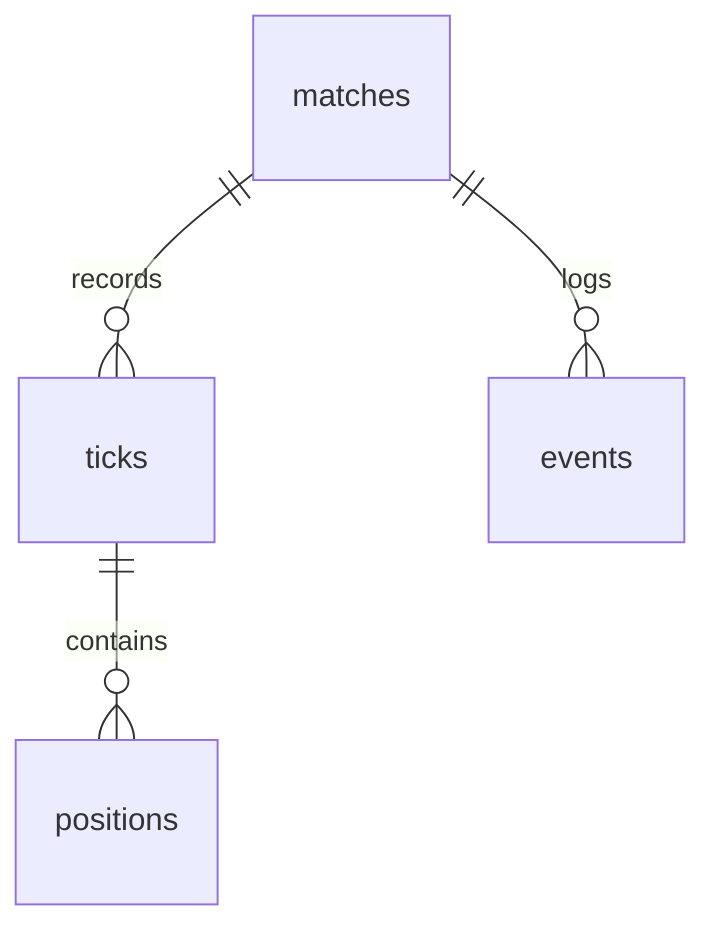

[← 返回 README](../../README.zh-CN.md) · [English](../en/database.md)

# 数据库

项目沿用上游 v0.2.0 的 SQLite 表结构，SQL 位于 `storage/db.py` 的 `_create_tables`。比赛行保存地面与空中地图哈希、初始占领点摘要、核弹标记及空中坐标换算参数。网页通过哈希取得地图 ID、名称和战斗类型。

## 规范化存储

每个 tick 保存比赛 ID、整数毫秒时间戳、载具与兵种 ID，以及空中视角标记。位置行引用所属 tick，保存对象坐标、颜色、类型、图标和 POI 标记。坐标保留五位小数，换算后的地面坐标可为空。

枚举表集中保存位置与 tick 中重复的字符串。每个连接缓存自己的枚举 ID，事务提交后才把新 ID 加入缓存。接口只需发送一次 tick 元数据，位置通过 `tick_id` 引用它。

`events` 表保存战斗播报：比赛 ID、收到时刻相对比赛开始的毫秒数（与 tick 同一基准）、游戏消息 ID、原文和整条原始 JSON。

## 录像表

`replays` 每行一份导入的录像，按场次号和是否服务器录像唯一，引用所属比赛。`replay_players`、`replay_kills`、`replay_chat` 分别保存玩家战绩、玩家击杀记录和聊天，时间为相对录像开始的毫秒数。重新导入同一份录像时整体替换；删除比赛时一并删除。`replays.wrote_tracks` 标记这份录像是否为比赛写入了轨迹；`replays.parser_version` 记录完整解析的版本：文件夹导入只读摘要，记为 0；打开比赛时，版本低于当前的录像会重新完整解析；完整解析失败时把版本记为当前版本，原因写进 `replays.parse_error`。`map_bounds` 按地图图片的存储键保存小地图的世界坐标范围。详见[游戏录像](replay.md)。

## 读取与清理

`GET /api/match/<id>/positions` 返回 `ticks` 和 `positions`。整数 `since` 按毫秒解释，小数按秒解释，结果包含起点时间戳。回放器关联两份列表，存在换算结果时使用地面坐标。录像写入的位置还带 `unit_name`、`unit_vehicle`（玩家名与载具，存为 `positions.unit_name_id` → `enum_unit_names`、`positions.unit_vehicle_id` → `enum_vehicle_types`），8111 记录为空。`GET /api/match/<id>/events?since=<毫秒>` 按时间升序返回播报。离场消息使用界面语言，同一玩家在同一时间戳的重复离场消息合并显示。

数据库采用 WAL，采集线程和网页请求各自打开连接。删除已结束比赛时，在同一事务中删除播报、位置、tick 和比赛行，再请求增量回收。已有数据库沿用原 SQLite 自动回收模式。采集启动时结束上次中断遗留的比赛。
