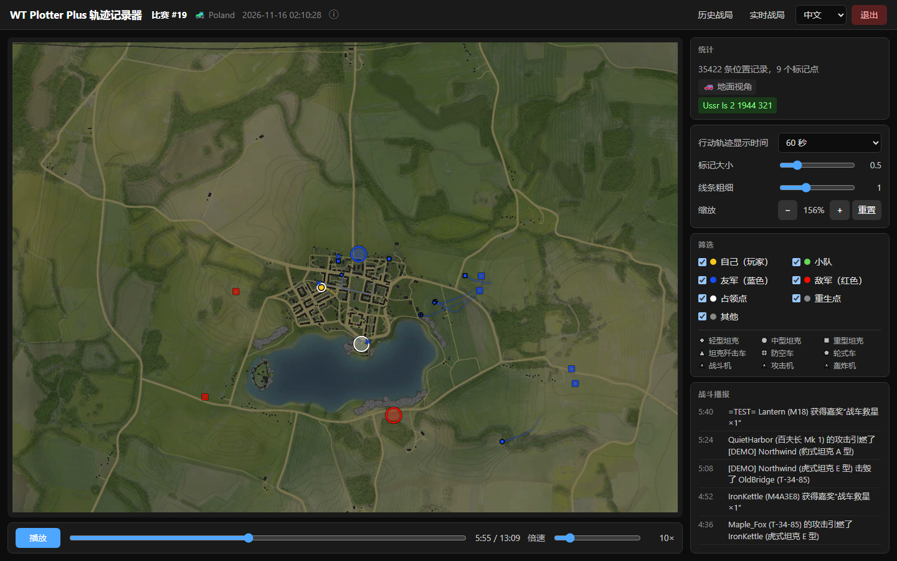
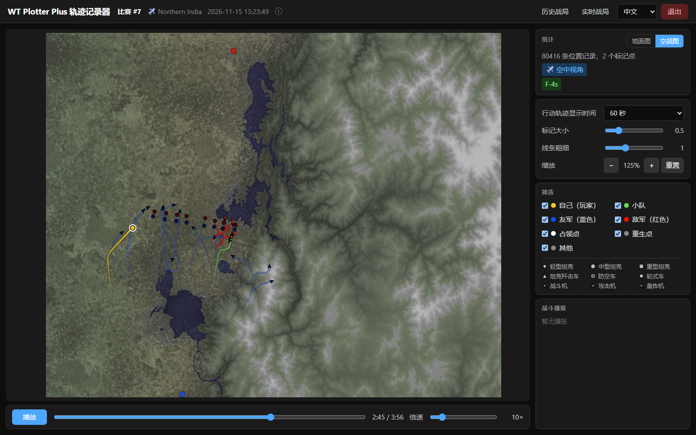

[← 返回 README](../../README.zh-CN.md) · [English](../en/viewer.md)

# 战局查看器

导航栏的“历史战局”列出所有记录过的战局，点进去就是回放页；“实时战局”显示正在进行的一局。两个页面的地图和侧栏是一样的。

## 读图

- **颜色是阵营**：黄色是自己，绿色是小队，蓝色是友军，红色是敌军，灰色是其他。
- **形状是兵种**：菱形轻型坦克、圆形中型坦克、方形重型坦克、三角形坦克歼击车、带十字的圆防空车、五边形轮式车和步兵战车、箭头是飞机（战斗机、攻击机、轰炸机依次变大）。自己是带白圈的圆点。侧栏有图例。
- **线是行动轨迹**：从当前位置往回画，越旧越淡。箭头朝向最后一段轨迹的方向。
- **× 是阵亡位置**：只给自己、小队和友军画。轨迹中断超过 6 秒才算阵亡。
- **大圆圈是占领点**，颜色是当前归属（蓝、红、白色中立）；**小方块是重生点**。
- 鼠标停在单位上显示兵种；停在自己身上还显示载具型号。

火炮、碉堡、舰船和固定防空目前不显示。

敌方单位只在被发现时出现在小地图上。消失不超过 6 秒再出现的，会接回原来的轨迹，中间不画线；敌方消失不代表阵亡，所以不画 ×。

## 回放

地图下方是播放条：

- **播放 / 暂停**：播到结尾会停下；在结尾按播放会从头开始。
- **时间轴**：拖动到任意时刻。
- **倍速**：5×～40×，默认 10×。

地图上滚轮缩放（50%～500%），按住拖动平移，双击复位。侧栏也有缩放按钮。

## 侧栏设置

| 设置 | 说明 |
| --- | --- |
| 行动轨迹显示时间 | 10、30、60、120 秒或全部，默认 30 秒。选“全部”时不淡化。 |
| 标记大小 | 0.25～1.5，默认 0.5 |
| 线条粗细 | 0.5～2 倍，默认 1 |
| 筛选 | 按阵营、占领点、重生点显示或隐藏 |

这些设置连同倍速保存在浏览器里，下次打开还在。换浏览器或清除网站数据后恢复默认。

实时和回放页都可以打开「显示所有队友死亡位置」。打开后，当前底图上到时间轴选定时刻为止已推断的小队和友军阵亡标记会在轨迹淡出后继续保留，仍受小队和友军筛选设置控制。

## 地面图与空战图

陆战里开过飞机的战局有两张底图，侧栏“统计”右边可以切换：

- **地面图**：显示地面单位。空中视角下看到的单位用换算后的坐标画在同一张图上。
- **空战图**：范围更大，只显示空中视角期间的数据，飞机也画出来。

第一次出击就是飞机的战局（空战）默认打开空战图。

## 战斗播报

侧栏最下面是战斗播报，最新的在最上面，内容跟着时间轴走：拖到哪一刻，就显示到那一刻为止的消息。文字是游戏客户端当时的语言，不随界面语言变化。

0.4.0 之前记录的战局没有播报。

## 实时战局

打开「实时战局」时如果没有进行中的战局，页面会等待，开局后自动刷新。对局中默认跟随最新时刻，每 0.5 秒检查一次更新。

拖动时间轴可以倒带。录制继续进行，地图和战报会停在选定时刻。点「播放」可从该时刻继续播放，点「回到实时」可直接跳到最新时刻。

一局结束后，顶栏标记变为「已结束」。如果正在倒带，页面会留在本局，回到实时后才会跟随下一局。采集程序停止时，地图上方会提示「采集已停止」。

## 历史战局

战局按本地开始日期分组，最新日期在前。可以筛选单日，点“全部日期”清除筛选。每行显示固定的战局序号、开始时间、时长、地图、初始占领点数和位置记录数。右侧的垃圾桶按钮可删除已结束的战局及其位置和播报。
